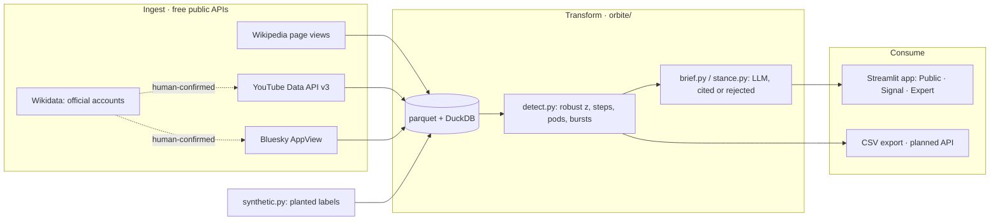

# Architecture

## Pipeline (ingest → transform → consume)

## Three stages

### Demo (now): daily, zero cost
- `collect.yml` runs once a day on GitHub Actions and commits `data/live/*.parquet`.
- Streamlit Community Cloud redeploys on push. Data cost 0 €; LLM optional (template fallback).
- Limits: git is not a database; Actions schedules can be delayed; Community Cloud is not EU-hosted and sleeps when idle.

### Pilot (Dec 2026 – Jan 2027): hourly
- Bluesky every hour (`cron: "7 * * * *"`), YouTube once a day (quota: ~2 units per channel + 1 per 100 comments; 50 channels ≈ 150 units/day of 10,000).
- Move parquet files from git to EU object storage (S3-compatible); `store.py` switches by changing `DATA` to an `s3://` path (DuckDB reads it directly with the httpfs extension).
- Email alerts when a watched figure gets a new signal.

### Production (spring 2027): near real time
- **Bluesky:** a long-running consumer of the Jetstream firehose on a small EU VM, filtered to watched accounts' DIDs; writes repost events (hashed) every minute.
- **YouTube:** polling within quota; request a quota extension only after the compliance audit.
- **App:** Streamlit or a React front end on an EU container host, a managed Postgres for users and plans, and payments through a provider (Stripe) for the 55 € tier.
- **Ops:** model version frozen per campaign, prompt log retained, correction log public, outputs paused on the eve and day of each vote.

## Method in one paragraph

For each figure, engagement per post is log-transformed and compared with the median and median absolute deviation (MAD) of its previous 60 posts: robust z = 0.6745 × (x − median) / MAD. A post is a signal above z 3.5, and only after 30 posts of history. Follower jumps use the same score on daily percent change, need at least 5% in a day, and are ignored if a signal post happened in the previous 48 hours; PELT change points confirm the jump lasts. Comment pods are posts where more than 30% of sampled comments repeat verbatim at least three times. Coordination bursts are 5+ distinct accounts reposting the same post within 60 seconds.
